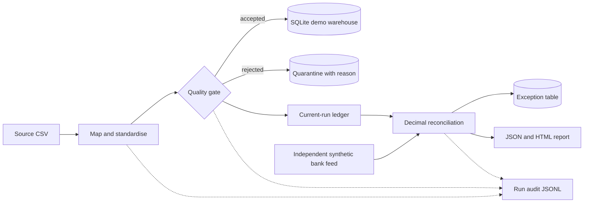

# Financial ETL & Reconciliation — Portfolio Edition

A runnable Python project for learning and demonstrating transaction ingestion,
data-quality controls, ledger-to-bank reconciliation, and automated testing.
All demo data is synthetic. The default warehouse is local SQLite; AWS tests use
mocked S3, so no cloud account is needed.

This is Deep Samaddar’s portfolio fork of
[Vinith Kumar G P’s original project](https://github.com/Vinithvk98/financial-etl-reconciliation).
The original MIT license and copyright are preserved. This edition adds
reliability fixes, regression coverage, a reproducible report, and explicit
operational limitations. See [the contribution guide](docs/portfolio.md).

[](https://github.com/Deepsamaddar/financial-etl-reconciliation/actions/workflows/ci.yml)

## What this edition improves

- **Cross-chunk duplicate detection:** a repeated transaction ID is quarantined
  even when it appears in a later source chunk.
- **Exact tolerance decisions:** reconciliation compares decimal values, so a
  difference of exactly 0.01 is accepted at a 0.01 tolerance.
- **Explicit invalid-feed failures:** duplicate or missing bank IDs and invalid
  amounts raise clear errors instead of multiplying joins or silently losing rows.
- **Reliable resets:** an empty replacement clears stale warehouse records.
- **Input controls:** missing source columns, blank keys, nonfinite amounts, and
  invalid chunk sizes are handled explicitly.
- **Reviewable outputs:** JSON metrics and a standalone HTML report generated
  directly from the run result.

## Run the demo

Use Python 3.10–3.12 (the CI matrix). From the repository root:

```bash
python -m venv .venv
source .venv/bin/activate
python -m pip install -r requirements.txt
python -m pytest -q
python -m src.generate_data --rows 50000 --out data/source
python -m src.pipeline --source data/source --reset --chunk-size 7000 --report-dir examples/demo
```

Windows activation: `.venv\Scripts\activate`.
Open `examples/demo/report.html` in a browser. `summary.json` contains the same
metrics in machine-readable form. The checked-in example is from a real local
synthetic-data run; it is not a production benchmark.

`--reset` replaces the demo tables. Without it, runs append data and are **not
idempotent**. Use a disposable local database for the walkthrough.

## Architecture



The source is processed in chunks. Reconciliation retains the current-run
ledger and bank feed in memory; the ID set also grows with source size.
**This implementation does not have constant memory use and has not been
validated at 10 million rows.**

## Reconciliation rules

| Outcome | Meaning |
|---|---|
| `matched` | Unique ID on both sides; absolute difference at or below tolerance |
| `amount_break` | Unique ID on both sides; difference above tolerance |
| `missing_bank` | Accepted ledger ID absent from bank |
| `missing_ledger` | Bank ID absent from accepted ledger, including quarantined source IDs |

Tolerance defaults to 0.01. Decisions use `Decimal`; exported SQL/report amount
columns use floating-point values for compatibility. IDs are globally unique,
and currencies must already agree for each ID; FX and currency mismatch handling
are not implemented. Bank IDs are loaded as text to preserve leading zeros.

## Tests and evidence

The suite covers transformation, data quality, reconciliation, mocked S3/Lambda,
chunk-boundary duplicates, invalid feeds, empty resets, and report consistency.
See [validation evidence](docs/validation.md) for the measured local run.
GitHub Actions runs Python 3.10, 3.11, and 3.12 plus a 50,000-row smoke test.
The badge reports this fork’s CI, not the upstream repository’s status.

## Configuration

| Variable | Default | Purpose |
|---|---|---|
| `ETL_TARGET_DSN` | local SQLite | SQLAlchemy connection string |
| `ETL_S3_BUCKET` | `fin-etl-landing` | Mock/demo S3 bucket |
| `ETL_ROWS` | `1000000` | Generator default; quickstart uses 50,000 |
| `ETL_CHUNK` | `250000` | Source chunk size |
| `ETL_SEED` | `42` | Reproducible synthetic input |

## Operational boundaries

This is a portfolio demo, not a production banking system. PostgreSQL/MSSQL DDL
is included but those backends have not been validated in this edition. The
Lambda handler is tested with moto, not deployed to AWS. It resets the warehouse
and requires both feeds to be present; it is not suitable for concurrent
production events. There is no run-wide transaction, replay protection,
authentication, currency reconciliation, or real account-reference lookup.
Failures after loading may leave partial data. Audit files are local append-only
logs, not tamper-proof compliance records. [Architecture notes](docs/architecture.md)
explain the tradeoffs and next steps.

## Project layout

```text
src/             pipeline stages and report generation
mapping/         source-to-target mapping and quality rules
sql/             reference PostgreSQL and MSSQL schemas
tests/           unit and mocked integration tests
examples/demo/   generated synthetic-data report and summary
docs/            architecture, contribution guide, validation evidence
.github/         CI matrix and pipeline smoke test
```

## License

MIT. Original copyright: Vinith Kumar G P (2026); see [LICENSE](LICENSE).
